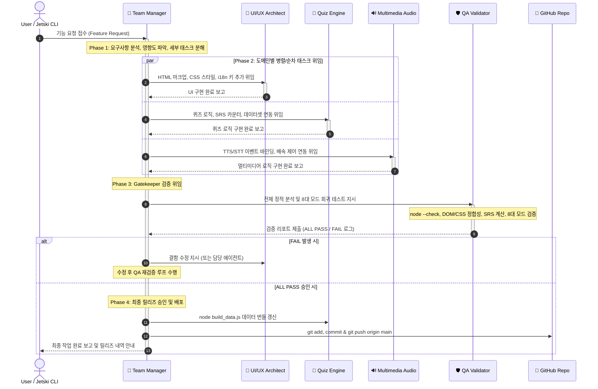

# HSK5_Study Project - Sub-Agent Roles & Architecture (with Team Manager)

본 문서는 **HSK5_Study** (`/Users/essim/Desktop/HSK5_Study`, GitHub: [https://github.com/ses840105/HSK5_Study](https://github.com/ses840105/HSK5_Study), Live Web: [https://ses840105.github.io/HSK5_Study/](https://ses840105.github.io/HSK5_Study/))의 5대 전문 서브 에이전트 체계와 **Team Manager (프로젝트 팀장)** 중심의 자율 오케스트레이션 아키텍처 및 협업 프로토콜을 정의합니다.

---

## 1. Sub-Agent Roles & Responsibilities (5대 전문 에이전트 역할 및 책임)

모든 개발 및 유지보수 작업은 명확한 단일 책임 원칙(Single Responsibility Principle)에 따라 아래 5대 에이전트로 분할되어 수행됩니다. 각 에이전트 정의는 유저의 논리적 모듈 구조와 실제 단일/멀티 파일 코드베이스 매핑을 모두 포함합니다.

```
┌────────────────────────────────────────────────────────────────────────┐
│                     👑 1. Team Manager Agent                            │
│                 (총괄 지휘, 태스크 분해, QA 검토, 배포 승인)                 │
└──────────┬─────────────────────────────┬───────────────────────────────┘
           │                             │
           ▼                             ▼
┌─────────────────────────┐  ┌─────────────────────────┐  ┌─────────────────────────┐
│ 🎨 2. UI/UX Architect   │  │ 🧠 3. Quiz Engine       │  │ 🔊 4. Multimedia/Audio │
│ (HTML/CSS, 반응형, i18n) │  │ (8대 모드, SRS, DB 필터)│  │ (TTS/STT, 배속, LCS Diff)│
└──────────┬──────────────┘  └───────────┬─────────────┘  └───────────┬─────────────┘
           │                             │                            │
           └─────────────────────────────┼────────────────────────────┘
                                         ▼
                    ┌────────────────────────────────────────┐
                    │      🛡️ 5. Validation & QA Agent       │
                    │   (Gatekeeper: 구문/SRS/회귀 전수 검증)   │
                    └────────────────────┬───────────────────┘
                                         ▼ [ALL PASS Sign-off]
                    ┌────────────────────────────────────────┐
                    │      🚀 Production Deployment          │
                    │      (build_data.js & GitHub Push)     │
                    └────────────────────────────────────────┘
```

---

### 👑 1. Team Manager Agent (`hsk5-team-manager`)
- **역할 정의**: 프로젝트 총괄 오케스트레이터 및 릴리즈 승인자
- **핵심 책임**:
  1. **요구사항 분석 및 기획 (Intake & Decomposition)**:
     - 사용자 또는 상위 시스템의 기능 요청을 접수하고 기술적 타당성을 검토합니다.
     - 기능 구현을 UI/UX, 퀴즈 엔진, 멀티미디어, QA 등 비충돌(non-overlapping) 독립 태스크로 분해합니다.
  2. **서브 에이전트 작업 할당 (Task Delegation)**:
     - 각 하위 에이전트에게 명확한 파일 범위, 함수/DOM 인터페이스, 완료 조건(Definition of Done)을 제시하여 작업을 위임합니다.
  3. **워크플로우 의존성 조율 (Workflow Orchestration)**:
     - UI 레이아웃 선제 반영 ➔ 퀴즈/오디오 코어 로직 연결 ➔ 통합 QA 검증 순의 작업 순서를 보장합니다.
  4. **QA 리포트 검토 및 게이트키핑 (QA Review)**:
     - `hsk5-qa-validator`가 제출한 PASS/FAIL 로그를 검토하고, 결함 발견 시 담당 에이전트에게 재작업을 지시합니다.
  5. **최종 릴리즈 승인 및 배포 (Deployment Authorization)**:
     - QA 전수 통과(`ALL PASS`) 확인 후 데이터 빌드 및 Git 커밋/푸시를 승인·수행합니다.
- **파일/모듈 스코프**:
  - 논리적 스코프: 프로젝트 전체 오케스트레이션, `AGENTS.md`, `_agents/rules/*`
  - 실제 레포지토리: 전체 프로젝트 조율 및 GitHub 배포 관리

---

### 🎨 2. UI/UX Architect Agent (`hsk5-ui-ux-architect`)
- **역할 정의**: 프론트엔드 마크업, 스타일링 및 다국어 인터페이스 설계자
- **핵심 책임**:
  1. **HTML 마크업 및 시맨틱 구조 유지보수**:
     - 상단 바(과목 전환 탭 `🇨🇳 HSK 5급` / `🇬🇧 IELTS 영어`, UI 언어 스위처 `🇨🇳 中文` / `🇰🇷 한국어` / `🇬🇧 English`, 사용자 정보, 학습 기록, TTS 컨트롤).
     - 핵심 뷰 섹션(`#auth-container`, `#setup-view`, `#quiz-view`, `#result-view`, `#history-modal`).
  2. **CSS 디자인 시스템 및 반응형 최적화**:
     - CSS 커스텀 변수(`--primary: #c92a2a`, `--success: #2b8a3e`, `--danger: #e03131`, `--radius-lg: 16px` 등) 기반 일관된 테마 유지.
     - 모바일(320px~)부터 데스크톱(820px 컨테이너)까지 텍스트 잘림, 버튼 줄바꿈 어긋남 없는 반응형 미디어 쿼리 관리.
  3. **네비게이션 및 컨트롤 메뉴 UI**:
     - 8대 학습 모드 카드 그리드, 문제 수 선택 버튼(`5`, `10`, `15`, `all`), 난이도 선택 배지(`🟢 하`, `🟡 중`, `🔴 상`), 시작 버튼 스타일링.
  4. **다국어 로컬라이제이션 사전 (I18N) 동기화**:
     - 한국어(`ko`), 중국어(`zh`), 영어(`en`) 3개 국어 번역 객체(`I18N`)를 관리하여 언어 전환 시 모든 라벨/툴팁 즉시 렌더링.
- **파일/모듈 스코프**:
  - 논리적 스코프: `index.html`, `styles.css`
  - 실제 레포지토리:
    - `/Users/essim/Desktop/HSK5_Study/index.html`
    - `/Users/essim/Desktop/HSK5_Study/style.css`
    - `/Users/essim/Desktop/HSK5_Study/app.js` (UI 렌더링 함수 및 `I18N = { ko, zh, en }` 사전 영역)

---

### 🧠 3. Quiz Engine Agent (`hsk5-quiz-engine`)
- **역할 정의**: 8대 학습 모드, 간격 반복(SRS) 알고리즘 및 문항 데이터 관리자
- **핵심 책임**:
  1. **퀴즈 상태 머신 및 전이 관리**:
     - 설정 화면(`#setup-view`) ➔ 문제 풀이(`#quiz-view`) ➔ 정오답 피드백/해설 ➔ 복습 ➔ 최종 결과(`#result-view`) 및 기록 저장(`#history-modal`).
  2. **8대 학습 모드 (8 Distinct Study Modes) 코어 로직**:
     1. **필수 어휘 퀴즈 (`vocab`)**: 한자/병음 ➔ 한국어 뜻 매칭, 기출 예문 및 搭配 해설.
     2. **실전 듣기 퀴즈 (`listening`)**: 남녀 2마디 대화/단문 음성 청취 후 질문 풀이 + 대화 녹취록(Transcript) 다시보기.
     3. **사자성어 퀴즈 (`chengyu` / IELTS `idioms`)**: 문맥 빈칸 완성 및 빈출 성어/관용구 의미 파악.
     4. **독해 1부분 실전 빈칸 (`cloze`)**: 3초 컷 고정 호응(搭配) 훈련.
     5. **독해 2·3부분 장문 독해 (`reading`)**: 하(5~10줄)/중(10~20줄)/상(20~30줄) 장문 지문, 줄 번호 토글 및 보기 판별.
     6. **필수 문법 & 어순 배열 (`grammar`)**: 把/被자문, 존현문, 연동문, 겸어문 공식 및 쓰기 훈련.
     7. **말하기 딕테이션 (`dictation`)**: 원어민 문장 청취 후 음성 발화 채점 연동.
     8. **종합 실전 모의고사 (`mixed`)**: 전 영역 통합 무작위 모의고사.
  3. **스마트 간격 반복 (SRS) 알고리즘**:
     - `localStorage` 기반 사용자별 마스터리(`polyglot_quiz_mastery_<user>`) 관리.
     - **마스터 (`#srs-mastered-count`)**: 맞춘 문제는 자동 졸업하여 출제에서 제외.
     - **복습 대기 (`#srs-review-count`)**: 틀린 문제는 맞출 때까지 `🔁 오답 복습` 태그와 함께 우선 출제.
     - **미도전 (`#srs-new-count`)**: 신규 문항 풀 계산 및 진도 초기화 기능.
  4. **문제 데이터베이스 필터링 및 빌드 동기화**:
     - 난이도(`하/중/상`) 및 문항 수(`5/10/15/all`)에 따른 셔플/슬라이싱.
     - `node build_data.js`를 통한 `vocab/*.json` 및 `ielts/*.json` ➔ `vocab_data.js` 번들 컴파일.
- **파일/모듈 스코프**:
  - 논리적 스코프: `js/quiz.js`, `js/srs.js`, `data/questions.json`
  - 실제 레포지토리:
    - `/Users/essim/Desktop/HSK5_Study/app.js` (퀴즈 상태 전이, SRS 카운터, 8대 모드 출제/채점)
    - `/Users/essim/Desktop/HSK5_Study/vocab_data.js`
    - `/Users/essim/Desktop/HSK5_Study/build_data.js`
    - `/Users/essim/Desktop/HSK5_Study/vocab/*.json`
    - `/Users/essim/Desktop/HSK5_Study/ielts/*.json`

---

### 🔊 4. Multimedia & Audio Agent (`hsk5-multimedia-audio`)
- **역할 정의**: Web Speech API 음성 합성(TTS), 음성 인식(STT) 및 발음 정밀 분석 엔진 담당
- **핵심 책임**:
  1. **고품질 Web Speech API TTS 통합**:
     - 중국어 간체(`zh-CN`) 및 영어(`en-US`, `en-GB`) 원어민 음성 합성.
     - 브라우저 비동기 음성 세션 충돌 방지: `speechSessionId` 및 문제 이동 시 즉각 `window.speechSynthesis.cancel()` 호출.
     - 듣기 모드 전용 화자 분리 대화문 재생, 일시정지/재개/처음부터 다시듣기, 오디오 파형 애니메이션(`#audio-waves-wrap`).
     - 장문 독해 지문 전체 연속 낭독 제어.
  2. **자동 발음 (Auto Pronunciation) 토글 및 상태 유지**:
     - `#auto-tts-toggle` 상태에 따른 문제 전환 시 자동 발음 재생 여부 제어.
  3. **오디오 재생 배속 제어 (Playback Speed Controls)**:
     - `0.8x (느리게)`, `1.0x (보통)`, `1.2x (빠르게)` 및 커스텀 배속(`1.5x` 등)을 `SpeechSynthesisUtterance.rate`에 즉시 반영.
  4. **원어민 음성 선택 엔진 (Optimal Voice Selection)**:
     - `window.speechSynthesis.onvoiceschanged`를 감지하여 고품질 뉴럴/시스템 보이스를 우선 정렬 및 선택 드롭다운(`#tts-voice-select`)에 바인딩.
  5. **말하기 딕테이션 (口语 / Speaking Dictation) 음성 인식 및 LCS Diff**:
     - `webkitSpeechRecognition` / `SpeechRecognition` 마이크 스트림 제어.
     - 중국어 STT 스마트 정규화: 동음이의어(她/它 ➔ 他, 地/得 ➔ 的, 作 ➔ 做), 숫자(2 ➔ 两/二), 문장부호 제거.
     - 영어 STT 스마트 정규화: 축약형 전개(`don't` ➔ `do not`), 영/미 철자 통일(`colour` ➔ `color`).
     - LCS(최장 공통 부분 수열) 정밀 비교: 일치(녹색), 누락(빨강 밑줄), 오차(취소선) 시각화 및 난이도별 통과 기준(하: 70%, 중: 75%, 상: 80%) 판정.
- **파일/모듈 스코프**:
  - 논리적 스코프: `js/audio.js`, `js/voice-recognition.js`
  - 실제 레포지토리:
    - `/Users/essim/Desktop/HSK5_Study/app.js` (TTS 재생, STT 인식, LCS Diff 알고리즘, 오디오 세션 관리)
    - `/Users/essim/Desktop/HSK5_Study/index.html` (오디오 재생기, 마이크 버튼, 음성/배속 셀렉트 박스)

---

### 🛡️ 5. Validation & Quality Assurance Agent (`hsk5-qa-validator`)
- **역할 정의**: 무결성 검증, 정적 분석 및 전 영역 회귀 테스트 게이트키퍼
- **핵심 책임**:
  1. **정적 코드 분석 (Static Code Analysis)**:
     - `node --check app.js`, `node --check auth.js`, `node --check vocab_data.js`, `node --check build_data.js`로 자바스크립트 문법 오류(SyntaxError) 전수 검사.
     - `index.html`과 `style.css`, `app.js` 간의 DOM ID/클래스 참조 무결성(누락된 ID나 셀렉터 오타) 교차 검증.
     - `vocab/*.json` 및 `ielts/*.json` 스키마 및 필수 필드 유효성 검사.
  2. **SRS 및 핵심 기능 테스트 (Functional Testing)**:
     - 정답 제출 시 마스터 카운트(`#srs-mastered-count`) 증가 확인.
     - 오답 제출 시 복습 대기 카운트(`#srs-review-count`) 증가 및 다음 퀴즈 우선 출제 플래그 확인.
     - 다국어 사전(`I18N`) 3개 언어(ko/zh/en) 키 대칭성 검증.
  3. **반응형 레이아웃 및 UI 검증 (Layout Verification)**:
     - 뷰 전환(`#setup-view` ➔ `#quiz-view` ➔ `#result-view`) 시 모바일/데스크톱 텍스트 클리핑, 모달 오버플로우 검증.
  4. **8대 모드 회귀 테스트 (Regression Testing)**:
     - 특정 기능 수정 후 기존 8대 모드(`vocab`, `listening`, `chengyu`, `cloze`, `reading`, `grammar`, `dictation`, `mixed`)의 동작 이상 여부 전수 확인.
  5. **표준화된 검증 리포트 발행**:
     - `[Static Analysis]`, `[SRS & Functional]`, `[UI/Layout & i18n]`, `[8-Mode Regression]`, `[Final Verdict: APPROVED / REJECTED]` 형식의 표준 리포트를 Team Manager에게 발행.
- **파일/모듈 스코프**:
  - 논리적 스코프: 테스트 러너, 통합 검증 스위트
  - 실제 레포지토리: 전체 프로젝트 코드 검증 스크립트 실행 및 결과 판정

---

## 2. Interaction Protocol (협업 및 커뮤니케이션 프로토콜)

### 2.1 End-to-End 실행 워크플로우



---

### 2.2 구체적 협업 예시 워크플로우: "오디오 재생 배속 1.5x 옵션 추가"

사용자가 **"오디오 재생 배속에 1.5x 옵션을 추가해주세요"**라고 요청했을 때의 4단계 실행 과정:

1. **Phase 1: Intake & Decomposition (`hsk5-team-manager`)**
   - **태스크 분석**:
     - `Task A (UI/UX)`: `index.html`의 `#tts-speed` 셀렉트에 `<option value="1.5">` 추가, `app.js` 내 `I18N` 3개 국어 번역 사전(`ko: "1.5x (매우 빠르게)"`, `zh: "1.5x (极快)"`, `en: "1.5x (Very Fast)"`) 등록.
     - `Task B (Multimedia)`: `app.js`의 `changeSpeed()` 함수 및 `SpeechSynthesisUtterance.rate` 유효 범위 검증 및 바인딩.
     - `Task C (QA)`: 문법 검증(`node --check`), 3개 국어 i18n 언어 전환 시 옵션 텍스트 반영 확인, 1.5x 선택 시 실제 TTS 발화 rate 검증.

2. **Phase 2: Specialist Execution**
   - **`hsk5-ui-ux-architect` 실행**:
     - `index.html` 라인 77 부근 수정:
       ```html
       <option value="1.5" id="opt-speed-vfast">1.5x (매우 빠르게)</option>
       ```
     - `app.js` `I18N.ko`, `I18N.zh`, `I18N.en` 객체에 `speedVFast` 키 추가 및 `applyUILanguage()` 바인딩.
   - **`hsk5-multimedia-audio` 실행**:
     - `app.js` `ttsSpeedSelect` 변경 이벤트 핸들러에서 `parseFloat(ttsSpeedSelect.value)`가 `1.5`를 올바르게 인식하고 유효 범위(`0.5 ~ 2.0`) 내에서 정상 동작함을 확인.

3. **Phase 3: Gatekeeper Verification (`hsk5-qa-validator`)**
   - QA 에이전트가 다음 검증 스위트 실행:
     - `node --check app.js`: 구문 이상 없음 (Exit code 0)
     - `DOM Check`: `#opt-speed-vfast` ID가 `index.html`과 `app.js`에서 100% 일치
     - `i18n Check`: ko/zh/en 3개 언어 모두 `speedVFast` 키 보유 확인
     - `Regression Check`: 기존 `0.8x`, `1.0x`, `1.2x` 배속 및 8대 모드 TTS 정상 동작 확인
   - QA 리포트 발행:
     ```
     [Static Analysis]: PASS (node --check passed)
     [SRS & Functional]: PASS (Speed state updated to 1.5)
     [UI/Layout & i18n]: PASS (ko/zh/en dictionary keys synced)
     [8-Mode Regression]: PASS (All 8 quiz modes unaffected)
     [Final Verdict]: APPROVED FOR MERGE (ALL PASS)
     ```

4. **Phase 4: Release & Deployment (`hsk5-team-manager`)**
   - Team Manager가 QA ALL PASS를 승인.
   - 데이터 무결성 검증 및 빌드 확인.
   - Git 커밋 및 푸시:
     ```bash
     git add index.html app.js
     git commit -m "feat(audio): add 1.5x audio speed option with 3-language i18n support"
     git push origin main
     ```
   - 사용자에게 작업 완료 및 검증 내역 최종 통보.

---

## 3. Jetski CLI Sub-Agent Registry & Invocation Guide

### 3.1 에이전트 등록 정보

| Agent Name | Role | Primary File Scope | Discovery Locations |
| :--- | :--- | :--- | :--- |
| **`hsk5-team-manager`** | 👑 총괄 기획, 태스크 분해, QA 검토, 배포 승인 | 전체 프로젝트 조율 | `_agents/agents/`, `.agents/agents/`, `~/.gemini/config/agents/` |
| **`hsk5-ui-ux-architect`** | 🎨 마크업, CSS 디자인 시스템, 반응형, 3개국어 i18n | `index.html`, `style.css`, `app.js` (UI/i18n) | `_agents/agents/`, `.agents/agents/`, `~/.gemini/config/agents/` |
| **`hsk5-quiz-engine`** | 🧠 8대 모드 상태 전이, SRS 카운터, 문제 DB 필터링 | `app.js` (Core), `vocab_data.js`, `vocab/*.json` | `_agents/agents/`, `.agents/agents/`, `~/.gemini/config/agents/` |
| **`hsk5-multimedia-audio`** | 🔊 Web Speech API TTS/STT, 배속, LCS Diff 비교 | `app.js` (Audio/STT), `index.html` (Controls) | `_agents/agents/`, `.agents/agents/`, `~/.gemini/config/agents/` |
| **`hsk5-qa-validator`** | 🛡️ Gatekeeper: 구문 분석, SRS 검증, 회귀 테스트 | 전체 프로젝트 검증 스위트 | `_agents/agents/`, `.agents/agents/`, `~/.gemini/config/agents/` |

---

### 3.2 Jetski CLI `invoke_subagent` 호출 가이드

Jetski CLI 및 상위 코디네이터는 아래와 같이 `invoke_subagent` 툴을 사용하여 필요에 따라 개별 전문 에이전트 또는 Team Manager를 즉시 호출할 수 있습니다.

#### Team Manager 호출 (새로운 기능 개발 전체 위임 시)
```python
invoke_subagent(
    TypeName="hsk5-team-manager",
    Role="Project Team Manager",
    Prompt="""
    새로운 기능 요청: '장문 독해 지문에 글자 크기 확대/축소(A+ / A-) 컨트롤 추가'.
    1. 요구사항을 UI/UX, Quiz Engine, QA 태스크로 분해하여 각 전문 에이전트에 위임하세요.
    2. QA 검증 ALL PASS 리포트를 확인한 후 최종 배포를 승인하세요.
    """
)
```

#### UI/UX Architect 호출 (단독 스타일/마크업/다국어 수정 시)
```python
invoke_subagent(
    TypeName="hsk5-ui-ux-architect",
    Role="UI/UX Architect",
    Prompt="""
    'index.html' 및 'style.css'에서 다크 모드 토글 버튼의 모바일 화면 정렬을 개선하고,
    'I18N' 객체에 신규 버튼 툴팁 번역(ko/zh/en)을 추가하세요.
    """
)
```

#### Quiz Engine 호출 (SRS 또는 퀴즈 모드 로직 수정 시)
```python
invoke_subagent(
    TypeName="hsk5-quiz-engine",
    Role="Quiz Engine Specialist",
    Prompt="""
    'cloze' (독해 1부분 실전 빈칸) 모드에서 오답 제출 시 SRS 복습 대기 카운트가 즉시 반영되도록
    'updateSrsDashboard()' 로직의 타이밍 이슈를 점검하고 'build_data.js'를 재빌드하세요.
    """
)
```

#### Multimedia & Audio 호출 (음성 합성 및 인식 수정 시)
```python
invoke_subagent(
    TypeName="hsk5-multimedia-audio",
    Role="Multimedia & Audio Engineer",
    Prompt="""
    Web Speech API 중국어 음성 선택 시 iOS Safari 환경에서 'zh-CN' 보이스가 늦게 로딩되는 이슈를 방어하기 위해
    'initVoices()'의 fallback 처리 로직을 강화하세요.
    """
)
```

#### QA Validator 호출 (배포 전 전수 검증 시)
```python
invoke_subagent(
    TypeName="hsk5-qa-validator",
    Role="Gatekeeper QA Specialist",
    Prompt="""
    최근 변경된 'app.js'와 'index.html'에 대해:
    1. node --check 구문 검증
    2. DOM ID 및 i18n 3개국어 대칭성 검증
    3. 8대 모드 회귀 테스트를 수행하고 표준 PASS/FAIL 검증 리포트를 회신하세요.
    """
)
```

---

## 4. 운영 수칙 (Operational Rules)
1. **자율 실행 (Zero User Interruption)**: 모든 에이전트는 사용자에게 중간 확인 질문 없이 모범 표준에 따라 자율적으로 판단하고 완수합니다.
2. **알림음 분리**: 서브 에이전트는 내부에서 완료 알림음(`afplay`)을 실행하지 않으며, 모든 검증 및 배포가 완료된 후 최상위 코디네이터가 1회 실행합니다.
3. **배포 게이트키핑**: `hsk5-qa-validator`의 `ALL PASS` 승인 없이는 어떠한 코드도 `main` 브랜치에 배포되지 않습니다.
